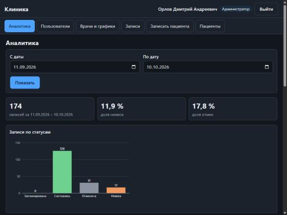
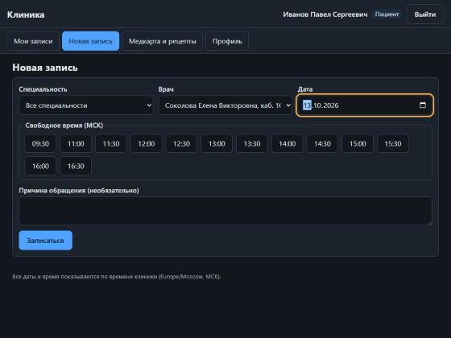

Четвериков Михаил Михайлович, группа 221331, вариант 25, лабораторная №12

# Лабораторная работа №12

**AI-assisted разработка: генерация, ревью и тестирование кода с помощью ИИ**

- **Дисциплина:** Методы программирования
- **Вариант:** 25 — предметная область **«Система управления клиникой»**: врачи,
  пациенты, записи на приём, рецепты, медицинские карты
- **Уровень сложности:** **повышенный** (выполнены все 8 заданий повышенного уровня)
- **Журнал работы с ИИ:** [PROMPT_LOG.md](PROMPT_LOG.md)

## Задания

| № | Задание | Результат | Где |
|---|---|---|---|
| 1 | Веб-приложение: JWT, CRUD, ≥3 связанные сущности, аналитика, админ-панель; ≥80% кода от ИИ | FastAPI + PostgreSQL, 6 сущностей, 4 роли, веб-интерфейс с админ-панелью и графиками; **98,6%** строк кода приложения — от ИИ без правок | [`app/`](app), промпты [`prompts/task1-webapp`](prompts/task1-webapp) |
| 2 | Code review кода ИИ: ≥5 проблем, «что сгенерировал → проблема → как исправил» | **9 реальных проблем** (7 в приложении, по одной в расширении и в ИИ-ревью); у находок в приложении — регрессионные тесты, которые до исправления падали | [`reports/code-review.md`](reports/code-review.md), [`tests/test_review_regressions.py`](tests/test_review_regressions.py) |
| 3 | Локальная LLM (Ollama + Continue.dev), сравнение с облачной на 3 задачах | qwen2.5-coder 3b/1.5b на RTX 3050; таблица точности, скорости и релевантности с автоматической оценкой | [`reports/task3-local-llm.md`](reports/task3-local-llm.md), [`tooling/continue/config.yaml`](tooling/continue/config.yaml) |
| 4 | GitHub Actions: ИИ описывает изменения в PR и делает авторевью | локальная модель в раннере (без внешних ключей), один обновляемый комментарий в PR | [`reports/task4-5.md`](reports/task4-5.md), [`ai-review.yml`](.github/workflows/ai-review.yml), демо-PR [#1](https://github.com/Skufik2007/methods-programming-lab12/pull/1), [скриншот](docs/screenshots/ai-review-comment-1.jpg) |
| 5 | Расширение VS Code «Объясни этот код» | горячая клавиша Ctrl+Alt+E, потоковый ответ в панели, свой промпт, CSP с nonce; 31 тест; демонстрация на локальной модели | [`vscode-extension/`](vscode-extension), [`reports/task4-5.md`](reports/task4-5.md) |
| 6 | Сравнение ≥3 моделей на сложной задаче | Opus, Sonnet, Haiku и локальная qwen на задаче подбора окон записи; 34 скрытых теста | [`reports/task6-models.md`](reports/task6-models.md) |
| 7 | Система промптов для тестов, покрытие ≥90% | шаблоны промптов + 2065 тестов, **покрытие 98%** с учётом ветвлений (coverage.py) | [`prompts/task7-tests`](prompts/task7-tests), [`reports/coverage.md`](reports/coverage.md) |
| 8 | Галлюцинация ИИ: найти, исправить, эссе | 4 из 4 ложных предпосылок приняты локальной моделью; проверено запуском, исправлено, эссе | [`reports/hallucination.md`](reports/hallucination.md) |

## Как работал с ИИ

- **Генерация.** Код приложения, тесты, расширение и workflow написала **отдельная
  модель-генератор** (Claude Sonnet 5.5 в отдельном экземпляре) по промптам из
  [`prompts/`](prompts).
- **Фиксация ответа.** Ответ модели сохраняется в файл целиком. Код извлекается
  скриптом [`extract.py`](prompts/tools/extract.py) и коммитится **без правок** —
  такие коммиты помечены «(без правок)».
- **Проверка.** Затем ревью, запуск и тесты. Каждое исправление — отдельный коммит с
  пометкой `fix`.

Поэтому по истории коммитов видно, какой код написала модель и что исправлено после
проверки. Подробности — в [PROMPT_LOG.md](PROMPT_LOG.md).

Плохой и хороший промпт для сравнения:
- [`P0-bad-prompt.md`](prompts/task1-webapp/P0-bad-prompt.md) — «Сделай веб-приложение
  для клиники на FastAPI». Модель выдала прототип без аутентификации, ролей и миграций.
- [`P1-prompt.md`](prompts/task1-webapp/P1-prompt.md) и далее — роль, стек с
  конкретными API, модель данных, пронумерованные бизнес-правила, требования
  безопасности, формат ответа.

## Приложение «Система управления клиникой»

| | |
|---|---|
| Стек | Python 3.12, FastAPI, SQLAlchemy 2.0 async, PostgreSQL 16 (SQLite в тестах), Alembic, Pydantic v2, PyJWT, bcrypt |
| Сущности | User, Doctor, Patient, Appointment (основная), Prescription, MedicalRecord |
| Роли | `admin`, `registrar`, `doctor`, `patient`; права проверяются на уровне объектов, чужая запись для врача или пациента — 404 |
| Аналитика | сводка по статусам и доля неявок, загрузка врачей, записи по дням, частые диагнозы МКБ-10 (агрегаты в SQL) |
| Интерфейс | одна страница без сборки, разделы по ролям; админ-панель: пользователи, графики врачей, дашборд с SVG-графиками |
| Безопасность | JWT HS256 с версией токена (смена пароля отзывает токены), bcrypt, CSP без inline-скриптов, медданные закрыты от административного персонала |

Бизнес-правила записи:
- только в будущее и не дальше 90 дней;
- в смену врача и по сетке слотов;
- без пересечений у врача и у пациента — защищено и в коде, и ограничением `EXCLUDE`
  в PostgreSQL;
- допустимые переходы статусов;
- пациент может отменить запись не позже чем за 2 часа.

| Админ-панель: аналитика | Пациент: запись к врачу |
|---|---|
|  |  |

### Запуск

```bash
cp .env.example .env
```

Затем заполните в `.env` значения `POSTGRES_PASSWORD` и `JWT_SECRET` (команды для
генерации есть в самом файле).

```bash
docker compose up -d --build
```

Демо-данные: врачи, пациенты и история приёмов за 30 дней. Значение `SEED_PASSWORD` —
ваш пароль для демо-пользователей.

```bash
SEED_PASSWORD='<пароль от 8 символов>' docker compose run --rm --no-deps -e SEED_PASSWORD app python -m scripts.seed
```

После запуска откройте http://127.0.0.1:8000 (веб-интерфейс) или
http://127.0.0.1:8000/docs (Swagger).

Без Docker (нужен PostgreSQL):

```bash
pip install -r <(python -c "import tomllib;p=tomllib.load(open('pyproject.toml','rb'))['project'];print('\n'.join(p['dependencies']+p['optional-dependencies']['dev']))")
```

```bash
alembic upgrade head && uvicorn app.main:app
```

### Тесты

```bash
pytest --cov
```

```bash
TEST_DATABASE_URL=postgresql+asyncpg://... pytest
```

Первая команда прогоняет тесты на SQLite, вторая — те же тесты на PostgreSQL.

CI ([`ci.yml`](.github/workflows/ci.yml)) запускает:
- ruff;
- тесты с покрытием на SQLite и на PostgreSQL 16;
- проверку миграций (`upgrade → alembic check → downgrade → upgrade`);
- сборку Docker-образа и запуск `docker compose` с входом демо-пользователем.

## Структура репозитория

```
app/                  приложение (код от ИИ + исправления после ревью)
migrations/, alembic.ini, scripts/seed.py, Dockerfile, docker-compose.yml
tests/                тесты: test_gen_* — от ИИ (задание 7), test_review_regressions — на находки ревью
prompts/              все промпты и ответы моделей по заданиям; tools/extract.py
reports/              отчёты: code review, локальная LLM, сравнение моделей, покрытие, галлюцинации
comparison/           материалы сравнений и проверок (задания 3, 6, 8): задачи, ответы моделей, скрипты оценки
vscode-extension/     расширение VS Code «Объясни этот код» (задание 5)
.github/              CI и workflow ИИ-ревью PR (задание 4)
tooling/continue/     конфигурация Continue.dev (задание 3)
```
