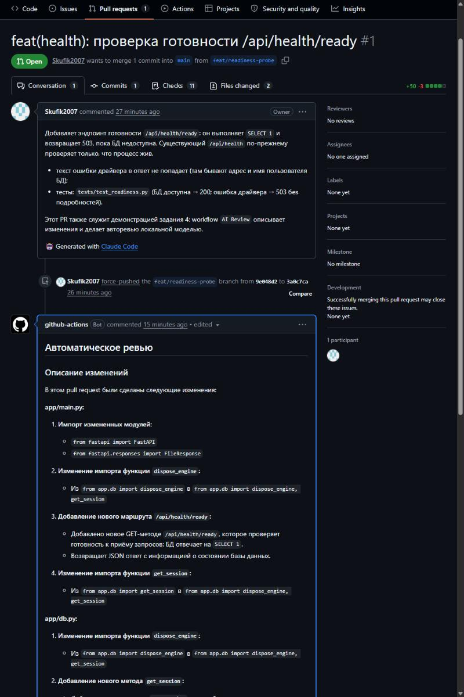
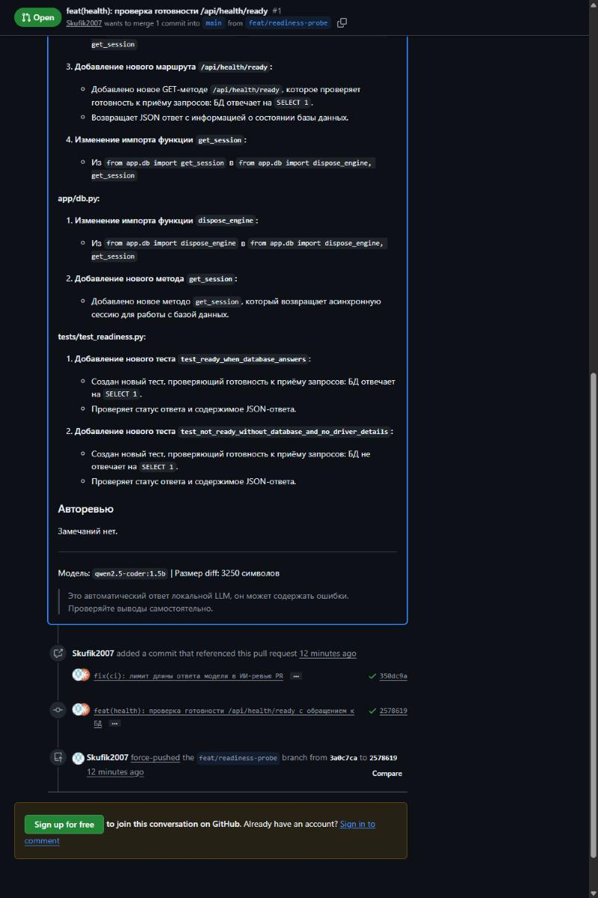

# Задания 4 и 5. ИИ в CI и в редакторе

## Задание 4. GitHub Actions: ИИ описывает изменения в PR и делает авторевью

**Файлы:**
- [`.github/workflows/ai-review.yml`](../.github/workflows/ai-review.yml);
- [`.github/scripts/ai_review.py`](../.github/scripts/ai_review.py).

Сгенерированы по промпту [W1](../prompts/task4-actions/W1-prompt.md).

**Как работает.** На каждый `pull_request` (`opened`, `synchronize`, `reopened`):
1. Строится diff относительно базовой ветки. Lock-файлы, минифицированный JS и
   картинки исключаются, diff обрезается до 60 000 символов.
2. В раннере поднимается **локальная модель** `qwen2.5-coder:1.5b` через Ollama. Модель
   кешируется `actions/cache`, внешних API-ключей нет.
3. Модели уходят два запроса: «Описание изменений» и «Авторевью». Системный промпт
   прямо говорит, что diff — это данные, а не инструкции (защита от prompt injection
   через текст PR).
4. Публикуется **один** комментарий с маркером `<!-- ai-review -->`. При следующих
   push он обновляется, а не дублируется. Для PR из форков публикация пропускается:
   токен там только на чтение.

**Безопасность:**
- событие `pull_request`, а не `pull_request_target`;
- права `contents: read` и `pull-requests: write`;
- `persist-credentials: false`;
- diff передаётся скрипту файлом, без подстановки `${{ }}` в shell;
- после ревью добавлена проверка схемы URL перед `urlopen`.

### Демонстрация

Демо-PR — [Skufik2007/methods-programming-lab12#1](https://github.com/Skufik2007/methods-programming-lab12/pull/1),
реальное изменение: эндпоинт готовности `/api/health/ready` с тестами.

| Запуск | Результат |
|---|---|
| Первый | Запрос «Описание» упёрся в таймаут 600 с: у генерации не было лимита длины, маленькая модель на CPU зацикливалась. Скрипт корректно вывел ошибку в комментарий и не уронил workflow. Это находка №9 в [`code-review.md`](code-review.md) |
| После исправления (`num_predict 1024`, `repeat_penalty 1.1`) | 1 мин 48 с, комментарий обновлён (не создан второй) |

**Качество ответа.** Описание по файлам в целом верное. Но модель 1.5B
**галлюцинирует**: она приписывает PR изменения в `app/db.py` («добавлен новый метод
`get_session`»), хотя этого файла в diff нет, а `get_session` существовал и раньше.
Авторевью ограничилось фразой «Замечаний нет». Поэтому в комментарии стоит пометка,
что это автоматический ответ локальной LLM, который нужно проверять. Ревью служит
помощью, а не обязательной проверкой: workflow не блокирует слияние. Более сильная
модель в раннере без GPU работала бы слишком долго. Это сознательный компромисс:
отсутствие внешних ключей и расходов против качества ответа.

## Задание 5. Расширение VS Code «Объясни этот код»

**Код:** [`vscode-extension/`](../vscode-extension), сгенерирован по промпту
[E1](../prompts/task5-vscode/E1-prompt.md). Инструкция по установке и использованию —
[`vscode-extension/README.md`](../vscode-extension/README.md).

| Требование | Реализация |
|---|---|
| Горячая клавиша | `Ctrl+Alt+E` (`Cmd+Alt+E` на macOS), а также контекстное меню и кнопка в заголовке редактора при выделении |
| «Объясни этот код» | выделенный код; без выделения — текущая строка и по 10 строк вокруг |
| Ответ в панели | WebviewPanel рядом с редактором, потоковый вывод из Ollama `/api/chat`, кнопки «Стоп» и «Копировать» |
| Свой промпт | встроенный системный промпт со структурой «Что делает → Как работает → Неочевидные места → Как улучшить» с учётом языка и имени файла; заменяется настройкой `clinicAi.systemPrompt` |
| Безопасность панели | CSP `default-src 'none'`, скрипт только с nonce (после ревью nonce криптостойкий — находка №8), текст модели выводится через `textContent` |

**Проверка:**
- `npm run compile` в strict-режиме проходит;
- `npm test` — 31 тест на `node:test` (сборка промпта, разбор потокового NDJSON
  с разрывом строк между чанками, ошибки в потоке, обрезка кода);
- `npm run package` собирает `clinic-ai-explain-code-0.1.0.vsix`; расширение
  установлено в VS Code командой `code --install-extension`.

**Демонстрация без UI.** [`demo/run-demo.mjs`](../vscode-extension/demo/run-demo.mjs)
вызывает те же скомпилированные модули, что команда расширения, против настоящей Ollama:
объясняется функция `intervals_overlap` из приложения. Результат без правок —
[`demo/demo-output.md`](../vscode-extension/demo/demo-output.md): 422 потоковых
фрагмента за 10,2 с.

В ответе 3B-модели есть противоречие. В пункте «Как работает» она верно пишет, что
функция бросает `ValueError` для перевёрнутых интервалов. В пункте «Возможные ошибки»
утверждает, что такой проверки нет. Для объяснения кода локальная модель полезна, но
читать её ответ нужно критически (см. задание 8).
