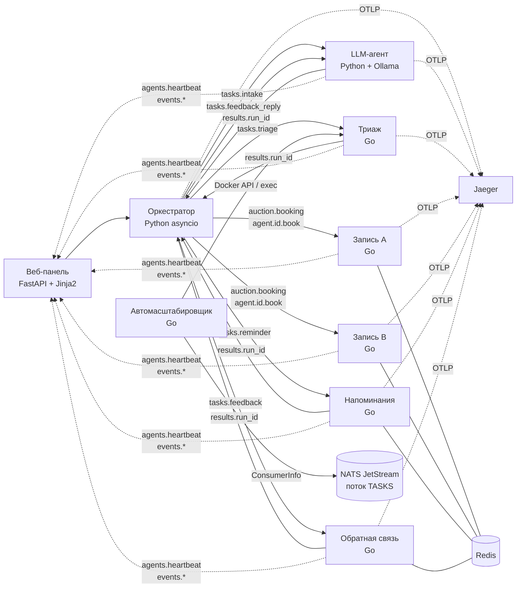

Четвериков Михаил Михайлович, группа 221331, вариант 18, лабораторная №13

# Мультиагентная система поддержки пациентов

[](https://github.com/Skufik2007/methods-programming-lab13/actions/workflows/ci.yml)

Тема — «Мультиагентные системы (MAS)». Вариант 18 «Система поддержки пациентов»: агенты
**записи к врачу**, **напоминания о приёме**, **сбора обратной связи** и **триажа**.
Уровень **повышенный**, выполнены все 8 заданий повышенного блока.

- Агенты — на Go (NATS / JetStream).
- Оркестратор, LLM-агент и веб-панель — на Python (asyncio, nats-py, FastAPI + Jinja2).
- Трассировка — OpenTelemetry → Jaeger, состояние — Redis, всё поднимается в Docker Compose.

Контракт сообщений и правил: [docs/ARCHITECTURE.md](docs/ARCHITECTURE.md). Работа с ИИ:
[PROMPT_LOG.md](PROMPT_LOG.md).

## Архитектура



Цепочка обработки обращения:
`Анализ обращения (LLM) → Триаж → Запись (аукцион) → Напоминание → Опрос после приёма`.
При красных флагах триаж останавливает цепочку с рекомендацией «Вызовите скорую: 103».

| Компонент | Код | Роль |
|---|---|---|
| Универсальный агент | [`agents/cmd/agent`](agents/cmd/agent) | один бинарник, поведение задаёт файл роли [`roles/*.md`](roles) — по рекомендации преподавателя (роль, правила, стиль общения, специализация) |
| Автомасштабировщик | [`agents/cmd/autoscaler`](agents/cmd/autoscaler) | экземпляры агента по длине очереди JetStream |
| Оркестратор | [`mas/orchestrator`](mas/orchestrator) | цепочка, повторы и таймауты, аукцион |
| LLM-агент | [`mas/llm_agent`](mas/llm_agent) | классификация жалобы и ответ на отзыв, без модели — правила |
| Веб-панель | [`mas/dashboard`](mas/dashboard) | агенты, очереди, запуски, журнал, трассы, ручной запуск |

## Задания

| № | Задание | Отчёт | Главное доказательство |
|---|---|---|---|
| 1 | Система из 3–5 агентов на Go | [task1](reports/task1-agents.md) | 5 Go-агентов (4 вида) + 2 LLM-агента в сети |
| 2 | Цепочки задач (pipeline) | [task2](reports/task2-pipeline.md) | 40 из 40 обращений под нагрузкой прошли цепочку (CI) |
| 3 | Трассировка (Jaeger) | [task3](reports/task3-tracing.md) | одна трасса на запуск: 6 сервисов, 36 спанов; журнал «кто что получил и передал» |
| 4 | Агент с состоянием (Redis) | [task4](reports/task4-redis-state.md) | после `docker compose restart reminder` счётчик 44 → 45, напоминания не теряются |
| 5 | Динамическое масштабирование | [task5](reports/task5-autoscaling.md) | backlog 121 → триаж 1 → 3 экземпляра, после cooldown обратно 1 |
| 6 | Аукционное распределение | [task6](reports/task6-auction.md) | `cost = 0.5·(1−availability) + 0.3·load + 0.2·(1−skill)` |
| 7 | LLM-агент | [task7](reports/task7-llm-agent.md) | qwen2.5:3b через Ollama, защита от prompt injection, fallback |
| 8 | Веб-панель мониторинга | [task8](reports/task8-dashboard.md) | FastAPI + Jinja2, CSP, проверка XSS в браузере |

## Запуск

### Docker Compose

```bash
docker compose up -d --build --wait
```

- Веб-панель — http://localhost:8000, Jaeger — http://localhost:16686.
- LLM по умолчанию работает в режиме правил (`LLM_MODE=fallback`).
- С локальной моделью: `LLM_MODE=llm docker compose --profile llm up -d --build`. Профиль
  поднимает Ollama и загружает `qwen2.5:3b`.
- Сквозная проверка, та же, что в CI: `python scripts/e2e.py --phase before`.

### Без Docker (Windows, нативные бинарники)

Docker на машине разработки нет, поэтому стенд поднимается нативно:
- nats-server 2.15, Jaeger 2.22 и Garnet 2.2 (сервер Microsoft, совместимый с Redis) из
  `D:\dev\lab13-tools`;
- агенты, LLM-агенты, дашборд и автомасштабировщик (бэкенд `exec`).

```bash
powershell -File scripts/dev.ps1 start
```

`status` и `stop` — состояние и остановка; логи пишутся в `.run/logs/`.

## Тесты

| Набор | Где | Количество | Покрытие |
|---|---|---|---|
| Go: модульные и интеграционные (встроенный nats-server, miniredis, httptest вместо Docker API) | `agents/**/*_test.go` | 419 тестов и подтестов | 83–100% по пакетам с логикой |
| Python: модульные (фейковая шина `tests/fakes.py`) и интеграционные (настоящий NATS) | `tests/` | 265 | 94% пакета `mas` |
| Сквозная проверка в Docker Compose | `scripts/e2e.py` | 19 проверок | — |

```bash
cd agents && go test ./...
```

```bash
.venv/Scripts/python -m pytest tests --cov=mas
```

CI ([`.github/workflows/ci.yml`](.github/workflows/ci.yml)) выполняет три задачи:
- Go — `vet`, `test -race`, `gofmt`;
- Python — ruff и pytest с NATS JetStream;
- Docker Compose — сборка, `e2e.py`, перезапуск `reminder` и проверка восстановления.

## Что переиспользовано из ЛР №12

- **Расписание врача** (`app/services/scheduling.py`) перенесено на Go:
  [`internal/schedule`](agents/internal/schedule).
- **Клиент Ollama** (`.github/scripts/ai_review.py`, urllib) переписан на `httpx` async:
  [`mas/llm_agent/ollama.py`](mas/llm_agent/ollama.py). Сохранены `num_predict` и
  `repeat_penalty` против зацикливания маленьких моделей.
- **`SecurityHeadersMiddleware`** (CSP без `unsafe-inline`) и подход «без `innerHTML`»
  перенесены в [`mas/dashboard/security.py`](mas/dashboard/security.py).
- **Настройки ruff, pytest и coverage** взяты из `pyproject.toml`. Каркас Go-сервиса и
  Dockerfile — по образцу ЛР №11.

Учтены замечания проверки ЛР №12:
- подключения создаются в lifespan и фабриках, а не при импорте;
- тесты не импортируют приватные функции соседних модулей;
- пагинация везде одинаковая (`limit` / `offset`).
