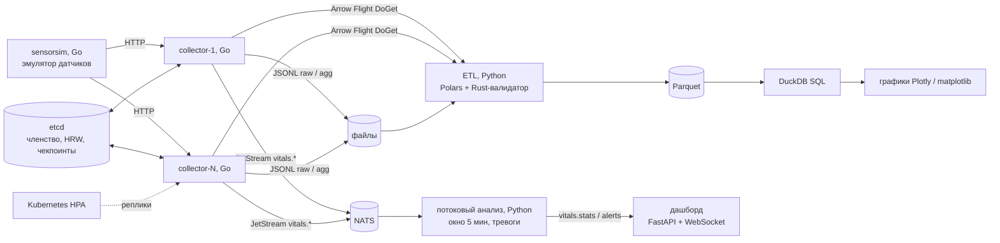

Четвериков Михаил Михайлович, группа 221331, вариант 22, лабораторная №14

# Конвейер сбора и анализа данных датчиков здоровья (Go + Python)

[](https://github.com/Skufik2007/methods-programming-lab14/actions/workflows/ci.yml)

Тема — «Разработка конвейеров обработки данных на Python и Go». Вариант 22: «Сбор и анализ
медицинских данных», источник — носимые датчики здоровья (эмуляция). Датчики снимают ЧСС,
SpO2, температуру, давление, частоту дыхания и шаги.

Уровень **повышенный**: выполнены все 8 заданий повышенного блока, к ним приложены
обязательные замеры производительности.

Контракт компонентов: [docs/ARCHITECTURE.md](docs/ARCHITECTURE.md). Работа с ИИ:
[PROMPT_LOG.md](PROMPT_LOG.md).

## Архитектура



| Компонент | Код |
|---|---|
| Эмулятор датчиков: детерминированный, клинические эпизоды, намеренные дефекты | [`go/cmd/sensorsim`](go/cmd/sensorsim) |
| Сборщик: горутины, буфер, пакетная запись, tumbling-окна, etcd, NATS, Arrow Flight, graceful shutdown | [`go/cmd/collector`](go/cmd/collector), [`go/internal`](go/internal) |
| Rust-валидатор (PyO3) | [`rust/vitals_validate`](rust/vitals_validate) |
| ETL: Polars, Parquet, DuckDB, графики, клиент Arrow | [`python/vitals/analytics`](python/vitals/analytics) |
| Потоковый анализ: NATS, скользящее окно, тревоги | [`python/vitals/streaming`](python/vitals/streaming) |
| Дашборд реального времени | [`python/vitals/dashboard`](python/vitals/dashboard) |
| Сборщик на Python (asyncio + aiohttp) и бенчмарки | [`python/vitals/pycollector`](python/vitals/pycollector), [`python/vitals/bench`](python/vitals/bench) |
| Docker, Compose, Kubernetes, CI | [`deploy/`](deploy), [`compose.yaml`](compose.yaml), [`k8s/`](k8s), [`.github/workflows/ci.yml`](.github/workflows/ci.yml) |

## Задания

| № | Задание | Отчёт | Главный результат |
|---|---|---|---|
| — | Базовый конвейер: сборщик → JSONL → Polars → Parquet → DuckDB → графики | [etl-pipeline](reports/etl-pipeline.md) | очистка 159 473 → 151 497 строк по 7 шагам; DuckDB быстрее Polars вдвое на фильтрах и группировках |
| 1 | Распределённый сборщик, координация через etcd | [task1](reports/task1-etcd.md) | HRW без лидера; при остановке сборщика его устройства забирает другой (CI) |
| 2 | Tumbling-окна в Go | [task2](reports/task2-tumbling-window.md) | окно 60 с сокращает записи в 42×, байты в 24× |
| 3 | Передача через Apache Arrow | [task3](reports/task3-arrow.md) | Flight: 46,5 байта на строку против 149,7 у JSONL; загрузка в Polars в 3,5× быстрее |
| 4 | Rust-валидатор через PyO3 | [task4](reports/task4-rust.md) | после оптимизации передачи данных в 1,36× быстрее Polars на 1 млн строк |
| 5 | Kubernetes + HPA | [task5](reports/task5-k8s-hpa.md) | kind в CI: CPU 985% от запроса → 3 реплики сборщика |
| 6 | Go и Python при сборе | [task6](reports/task6-go-vs-python.md) | Go в 2,3–3,3× быстрее и вдвое экономнее по памяти; Python упирается в одно ядро (GIL) |
| 7 | Потоковая обработка (NATS), скользящее окно 5 мин | [task7](reports/task7-streaming.md) | окно из 10-секундных корзин, 5 правил тревог с гистерезисом |
| 8 | Дашборд в реальном времени | [task8](reports/task8-dashboard.md) | FastAPI + WebSocket, графики на `<canvas>` без CDN, строгая CSP |

Все замеры собраны в [reports/bench/summary.md](reports/bench/summary.md).

## Запуск

### Docker Compose

```bash
docker compose up -d --build --wait
```

Поднимаются etcd, NATS, эмулятор, два сборщика, потоковый анализ и дашборд
(http://localhost:8000). Сквозная проверка — та же, что в CI: `python scripts/e2e.py`.

### Kubernetes

```bash
kubectl apply -k k8s/
```

Нужен metrics-server. В CI это делается в kind, см. задачу `k8s` в
[ci.yml](.github/workflows/ci.yml).

### Без Docker (Windows)

На машине разработки нет Docker, поэтому стенд поднимается из нативных бинарников:
etcd 3.7.2 и nats-server 2.15 из `D:\dev\lab14-tools` и `D:\dev\lab13-tools`.

```bash
powershell -File scripts/dev.ps1 start
```

Команды `status` и `stop` останавливают только свои PID.

ETL и замеры:

```bash
.venv/Scripts/python -m vitals.analytics run --source files --in data --out data/out
```

```bash
.venv/Scripts/python -m vitals.bench all
```

## Тесты

| Набор | Количество | Покрытие |
|---|---|---|
| Go (`go test ./...`, встроенные etcd и nats-server, Flight-клиент) | 92 | window 91%, sim 90%, config 95%, flightsink 83%, files 77%, coord 76%, natssink 61%, collector 56% |
| Rust (`cargo test`) | 9 | — |
| Python (`pytest tests`) | 108 | логика: окна и тревоги 100%, анализатор 92%, дашборд 92%, очистка 88%; весь пакет — 45% |

Общее покрытие Python ниже, чем у логики, из-за модулей ввода-вывода: раннеры бенчмарков,
построение графиков, CLI, сетевые циклы сборщика и потребителя. Их проверяют не модульные
тесты, а реальные запуски: полный прогон бенчмарков, ETL на данных эмулятора и сквозная
проверка в Docker Compose.

CI ([ci.yml](.github/workflows/ci.yml)) состоит из пяти задач:
- `go` — vet, `test -race`, gofmt;
- `rust` — `cargo test`, clippy;
- `python` — колесо maturin, ruff, pytest с NATS и etcd;
- `compose` — сборка и e2e на 9 проверок;
- `k8s` — kind, HPA.

## Что переиспользовано

- **Из ЛР №13:**
  - подход «контракт до кода»;
  - NATS JetStream с `Nats-Msg-Id` для дедупликации;
  - строгая CSP и `Referrer-Policy: same-origin` (там `no-referrer` ломал формы);
  - вывод только через `textContent`;
  - логи Python в UTF-8 на Windows.
- **Из ЛР №10:** путь PyO3 + maturin для Rust-модуля.
- **Из ЛР №11:** проверка Docker-части в CI, потому что Docker локально нет.
