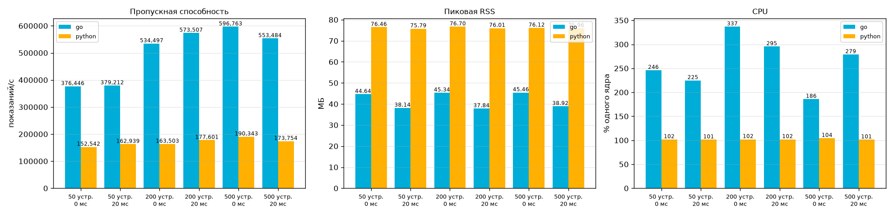

# Результаты замеров

Окружение: Windows-11-10.0.26300-SP0, Python 3.12.10, CPU: 12.

## Go и Python сборщик

EMIT=raw, WORKERS=16, 20 с на прогон, прогонов на точку: 3 (медиана), эмулятор с накопленными данными за 6 ч. CPU — % одного ядра.

| устройств | LATENCY_MS | сборщик | показ./с | пик RSS, МБ | CPU, % | прогонов |
|---|---|---|---|---|---|---|
| 50 | 0 | go | 376446 | 44.6 | 246 | 3 |
| 50 | 0 | python | 152542 | 76.5 | 102 | 3 |
| 50 | 20 | go | 379212 | 38.1 | 225 | 3 |
| 50 | 20 | python | 162939 | 75.8 | 101 | 3 |
| 200 | 0 | go | 534497 | 45.3 | 337 | 3 |
| 200 | 0 | python | 163503 | 76.7 | 102 | 3 |
| 200 | 20 | go | 573507 | 37.8 | 295 | 3 |
| 200 | 20 | python | 177601 | 76.0 | 102 | 3 |
| 500 | 0 | go | 596763 | 45.5 | 186 | 3 |
| 500 | 0 | python | 190343 | 76.1 | 104 | 3 |
| 500 | 20 | go | 553484 | 38.9 | 279 | 3 |
| 500 | 20 | python | 173754 | 76.0 | 101 | 3 |

Проверка сопоставимости: 18 из 18 пар прогонов — оба собрали данные и общие префиксы строк устройств совпали побайтно.

### Размер пакета (fsync после каждого пакета)

200 устройств, LATENCY_MS=0. Основная таблица снята с BATCH_SIZE=10000.

| BATCH_SIZE | сборщик | показ./с | CPU, % | прогонов |
|---|---|---|---|---|
| 500 | go | 164748 | 170 | 3 |
| 500 | python | 120997 | 102 | 3 |
| 5000 | go | 522959 | 337 | 3 |
| 5000 | python | 177396 | 104 | 3 |
| 20000 | go | 600172 | 179 | 3 |
| 20000 | python | 194210 | 102 | 3 |

## JSONL и Arrow Flight

| набор | формат | строк | Б/строку | передача, мс | загрузка, мс | мкс/строку |
|---|---|---|---|---|---|---|
| raw | jsonl | 84340 | 149.7 | 10.9 | 16.9 | 0.33 |
| raw | flight | 84340 | 46.5 | 53.0 | 4.8 | 0.68 |
| agg | jsonl | 6915 | 258.5 | 0.6 | 3.5 | 0.59 |
| agg | flight | 6915 | 89.8 | 16.2 | 1.2 | 2.54 |

## raw и agg

| WINDOW, с | raw записей | agg записей | сокращение (записи) | raw байт | agg байт | сокращение (байты) | показаний на agg-строку |
|---|---|---|---|---|---|---|---|
| 10 | 11978 | 1400 | 8.6 | 1793004 | 361838 | 5.0 | 10.0 |
| 60 | 29536 | 700 | 42.2 | 4429621 | 186914 | 23.7 | 42.5 |

Часть agg-строк — неполные окна на старте и при остановке, поэтому устойчивое сокращение ближе к последнему столбцу.

## Rust и Polars (валидация, 1,000,000 строк)

| реализация | время, мс (медиана) | ускорение относительно Polars |
|---|---|---|
| Polars | 94.0 | 1.00 |
| Rust | 69.2 | 1.36 |

Результаты совпали: True.

