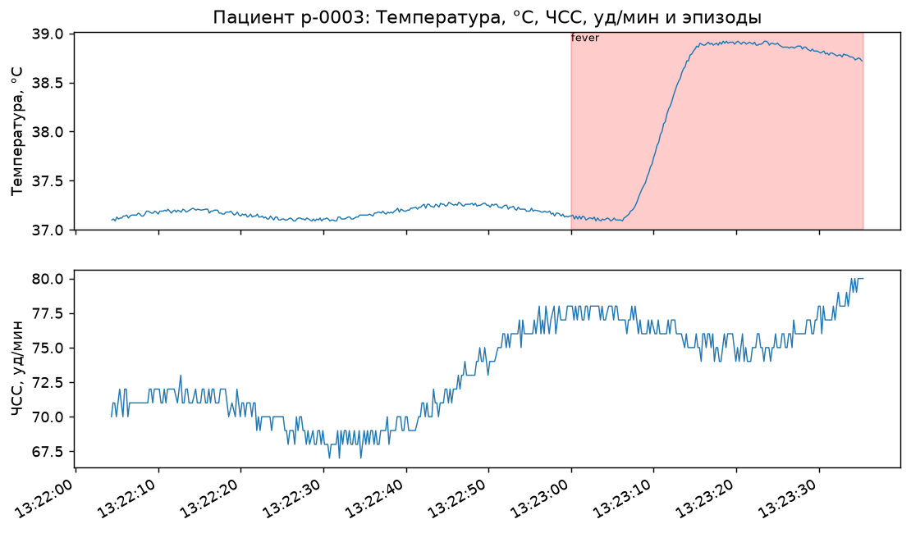
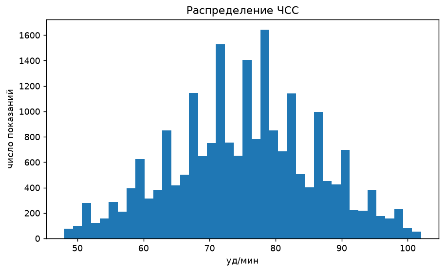
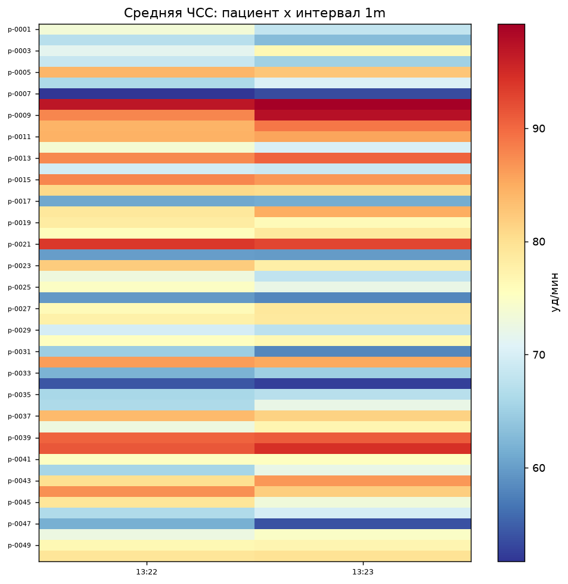
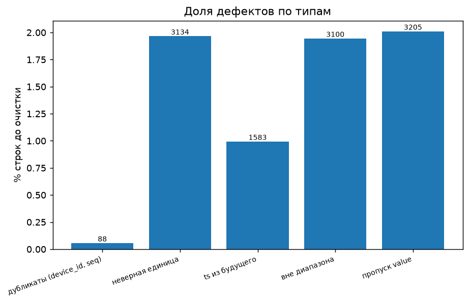

# Базовый конвейер: Go-сборщик → JSONL → Polars → Parquet → DuckDB → графики

Задания повышенного блока надстраиваются над базовым ETL-конвейером. Его результаты
приведены здесь: на них опираются отчёты по заданиям.

## Сбор

[`go/cmd/sensorsim`](../go/cmd/sensorsim) эмулирует носимые датчики. Генерация
детерминирована по `SEED`: показание — функция `(SEED, устройство, номер)`, хранить ничего
не нужно.
- 7 показателей с плавным дрейфом;
- клинические эпизоды у 35% пациентов;
- намеренные дефекты по 1–3%: вне диапазона, `null`, дубликаты, неверные единицы,
  метки времени из будущего.

[`go/cmd/collector`](../go/cmd/collector) опрашивает устройства пулом горутин:
- буферизованный канал;
- пакетная запись по размеру или по таймеру;
- graceful shutdown из 7 шагов.

Прогон для отчёта: 50 устройств, 5 показаний/с на устройство, 90 с.

## Очистка ([cleaning_report.json](etl/cleaning_report.json))

| Шаг | Строк до | Строк после | Затронуто |
|---|---|---|---|
| приведение типов | 159 473 | 159 473 | 0 |
| дубликаты `(device_id, seq)` | 159 473 | 159 385 | 88 |
| нормализация единиц | 159 385 | 159 385 | 3 134 исправлено |
| `ts` из будущего | 159 385 | 157 802 | 1 583 |
| валидация (Rust): вне диапазона, неизвестная метрика, единица | 157 802 | 154 702 | 3 100 |
| пропуски `value` | 154 702 | 151 497 | 3 205 |
| `battery` — последним известным по устройству | 151 497 | 151 497 | 1 530 заполнено |

Итог: 159 473 → 151 497 строк (−5,0%). Это совпадает с заданными долями дефектов эмулятора.

## Parquet и DuckDB ([timings.json](etl/timings.json), медиана 5 прогонов)

Чистые данные сохраняются в Parquet: `clean/` с партиционированием по `metric`, агрегаты —
`agg.parquet`. Одни и те же запросы выполняются в DuckDB (SQL к Parquet) и в Polars.
Совпадение результатов проверяется в коде.

| Запрос | DuckDB, мс | Polars, мс | Совпадают |
|---|---|---|---|
| фильтр | 3,7 | 6,3 | да |
| группировка | 10,4 | 19,8 | да |
| топ-10 с сортировкой | 7,6 | 7,4 | да |
| скользящее среднее ЧСС (оконная функция) | 15,7 | 10,8 | да |

На фильтрах и группировках DuckDB быстрее примерно вдвое. На оконной функции быстрее Polars.

## Визуализация (HTML Plotly + PNG)

| | |
|---|---|
|  |  |
|  |  |

Найдено 5 эпизодов по правилам раздела 7: лихорадка — 3, гипертония — 1, десатурация — 1.

| № | Находка | Решение |
|---|---|---|
| 6 | Временной ряд всегда рисовал ЧСС и SpO2. У пациента с лихорадкой красная полоса закрывала графики без отклонений, причём тянулась за конец данных | Панели выбираются по метрикам эпизодов пациента, полоса рисуется только на своей панели. Тест падал до правки |
