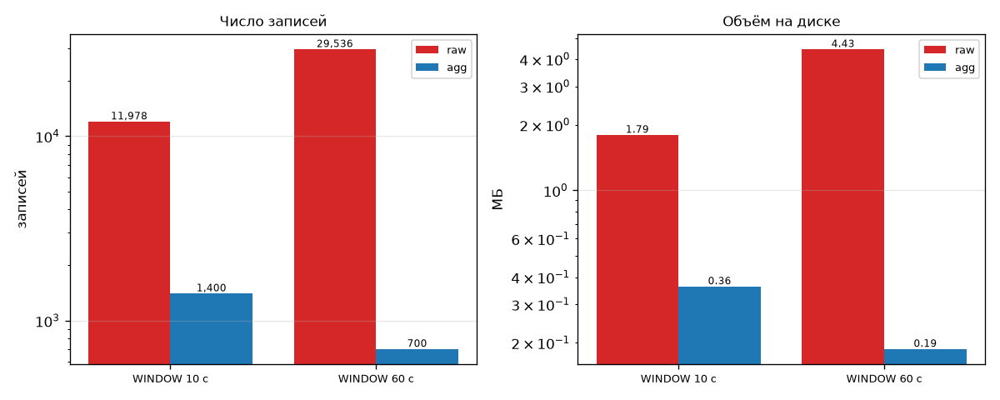

# Задание 2. Оконная агрегация в Go перед отправкой в Python

**Требование:** агрегировать данные tumbling-окнами на стороне Go и отправлять в Python не
исходные записи, а агрегаты; это снижает объём передаваемых данных.

## Что сделано

Пакет [`go/internal/window`](../go/internal/window), контракт —
[раздел 2.4](../docs/ARCHITECTURE.md).

- Окна tumbling, полуоткрытые `[start, end)`, выровнены по эпохе. Ключ —
  `(device_id, metric, window_start)`.
- Агрегат: `count`, `invalid`, `sum`, `min`, `max`, `mean`, `last`. Невалидные значения
  (`null`, NaN, вне диапазона) в статистику не входят и считаются отдельно в `invalid`.
- Окно закрывается при `now ≥ window_end + WINDOW_LATENESS`. Опоздавшие показания
  считаются в `late_dropped`, а не пропадают молча.
- Режим `EMIT=raw|agg|both` — по агрегатам Python работает без сырых записей. При
  остановке сборщика открытые окна закрываются досрочно, это отмечается в логе.
- Повтор `seq` учитывается в окне один раз, иначе исказились бы `count`, `sum` и `mean`.
- Часы инжектируются, поэтому окна проверяются тестами без `time.Sleep`.

## Замеры ([reports/bench/raw_vs_agg.json](bench/raw_vs_agg.json))

Эмулятор, 20 устройств, реальное время:

| Окно | raw записей | agg записей | Сокращение по записям | raw байт | agg байт | Сокращение по байтам |
|---|---|---|---|---|---|---|
| 10 с | 11 978 | 1 400 | **8,6×** | 1 793 004 | 361 838 | **5,0×** |
| 60 с | 29 536 | 700 | **42,2×** | 4 429 621 | 186 914 | **23,7×** |

Объём сокращается меньше, чем число записей: строка агрегата длиннее строки показания
(≈ 258 байт против 150). Часть agg-строк — неполные окна на старте и при остановке, поэтому
устойчивое сокращение ближе к «показаний на agg-строку»: 10 для окна 10 с и 42,5 для окна 60 с.

## Проверка

- Тесты [`window_test.go`](../go/internal/window/window_test.go) (генератор T1):
  - границы и выравнивание окна;
  - закрытие на фейковых часах;
  - `late_dropped`;
  - агрегаты;
  - окно без валидных значений;
  - NaN и будущий `ts`.
- Python-сборщик реализует те же окна. Его agg-строки совпадают с Go по формату и числу
  (420 при 20 устройствах), тесты — [`test_pycollector.py`](../tests/unit/test_pycollector.py).
