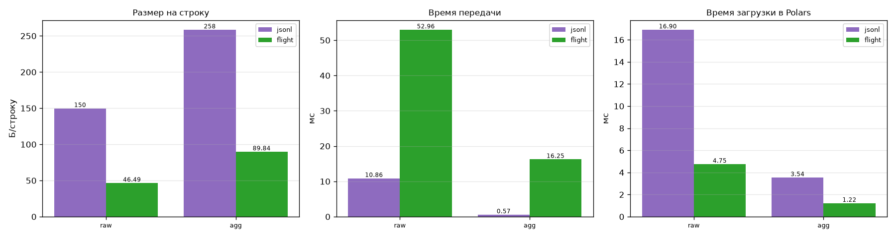

# Задание 3. Передача данных через Apache Arrow

**Требование:** заменить передачу через JSON-файлы на Apache Arrow (Flight RPC или
RecordBatch): Go-сервер отдаёт данные в формате Arrow, Python-клиент принимает. Сравнить
производительность и объём.

## Что сделано

- **Go-сервер Arrow Flight** в сборщике ([`flightsink`](../go/internal/sinks/flightsink),
  `github.com/apache/arrow-go/v18`):
  - кольцевой буфер за последние 15 мин;
  - `DoGet` с JSON-тикетом `{"kind": "raw"|"agg", "since": ...}`, батчи по 8192 строки;
  - `ListFlights`, `GetFlightInfo`.

  Схема строго по [разделу 6 контракта](../docs/ARCHITECTURE.md): строки идентификаторов —
  словарные (`dictionary<int32, utf8>`), время — `timestamp[ms, UTC]`, nullable только у
  `value`, `battery` и пустых агрегатов. Адрес сервера публикуется в etcd.
- **Python-клиент** ([`analytics/load.py`](../python/vitals/analytics/load.py),
  `pyarrow.flight`):
  - забирает данные с нескольких сборщиков;
  - склеивает их и передаёт в Polars;
  - ETL запускается как `--source flight`.

## Замеры ([reports/bench/transport.json](bench/transport.json), медиана 3 прогонов)

| Набор | Формат | Строк | Байт на строку | Передача, мс | Загрузка в Polars, мс |
|---|---|---|---|---|---|
| raw | JSONL | 84 340 | 149,7 | 10,9 | 16,9 |
| raw | Arrow Flight | 84 340 | **46,5** | 53,0 | **4,8** |
| agg | JSONL | 6 915 | 258,5 | 0,6 | 3,5 |
| agg | Arrow Flight | 6 915 | **89,8** | 16,2 | **1,2** |

Выводы:
- **Объём.** Arrow компактнее JSONL в 3,2 раза на raw и в 2,9 раза на agg: словарные
  строки и двоичные числа вместо текста.
- **Загрузка в Polars** из Arrow быстрее в 3,5 раза на raw и в 2,9 раза на agg: нет разбора
  текста, столбцы почти без копирования переходят в Polars.
- **Передача.** Flight медленнее, и это честное ограничение замера. JSONL здесь — чтение
  локального файла с диска, а Flight — gRPC-запрос к сборщику через loopback, где сервер
  каждый раз строит батчи из буфера. По сети между машинами файл тоже пришлось бы
  передавать, и меньший объём Arrow дал бы выигрыш. Отдельно это не измерялось.

## Проверка

- Вручную: ETL `--source flight` забрал у работающего сборщика 33 239 raw-строк и
  630 agg-строк, очистка дала 31 572 строки.
- CI, e2e: «Arrow Flight DoGet localhost:8815» и «… :8816» — оба сборщика отдают строки.
- Тесты [`flightsink_test.go`](../go/internal/sinks/flightsink/flightsink_test.go):
  - схема и словари;
  - нарезка на батчи (20 000 строк → 8192 / 8192 / 3616);
  - null;
  - `DoGet` через Flight-клиент.
