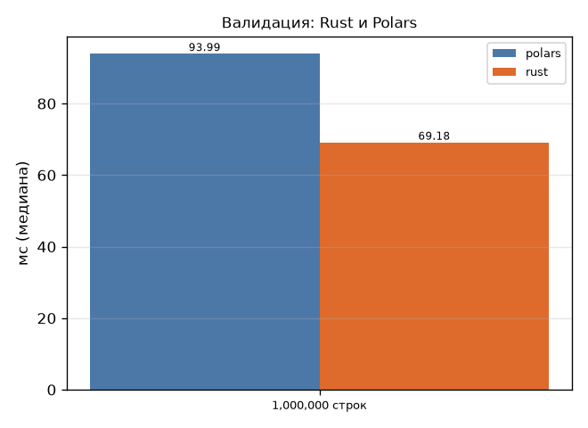

# Задание 4. Интеграция Rust-библиотеки для валидации

**Требование:** написать на Rust библиотеку валидации данных (формат полей, диапазоны) и
встроить её в Go через cgo или в Python через PyO3.

## Что сделано

Крейт [`rust/vitals_validate`](../rust/vitals_validate) (PyO3 0.25, numpy, abi3-py312,
сборка maturin) встроен в шаг очистки Python-конвейера.

- `validate_row` — чистая функция. Возвращает коды 0–4 (ок, пропуск, вне диапазона,
  неизвестная метрика, неверная единица) с приоритетом при нескольких нарушениях. Границы
  включительно.
- `validate_coded(metric_codes, metric_dict, value, unit_codes, unit_dict)` — основной вход.
  Строковые столбцы приходят как int32-коды словаря из `pyarrow.compute.dictionary_encode`,
  значения — numpy без копии. Строки сравниваются один раз на элемент словаря, цикл идёт без
  GIL (`allow_threads`).
- `ranges()` — таблица диапазонов. Python-обёртка
  [`validation.py`](../python/vitals/validation.py) берёт её из модуля.
- Запасная реализация на чистом Polars с тем же контрактом служит для сравнения скорости и
  для работы без собранного модуля. Результаты обеих сверяются тестом на 150 000 строк с
  дефектами и граничными значениями.
- В CI задача `rust` запускает `cargo test` и `clippy -D warnings`. Python-образ собирает
  колесо maturin на первом этапе.

## Замеры (1 млн строк)

| Реализация | Время |
|---|---|
| Rust, первая версия: строки через `to_list()` | 0,249 с |
| Чистый Polars | 0,094–0,179 с |
| **Rust, коды словаря** | **0,069–0,090 с** |

Диапазон — разные прогоны (одиночный замер и медиана в полном бенчмарке
[`validation.json`](bench/validation.json)). Во всех прогонах Rust быстрее Polars:
в полном бенчмарке в **1,36 раза**, результаты совпали.

## Находки

| № | Что было | Решение |
|---|---|---|
| 1 | Генератор честно сообщил, что Rust через обёртку медленнее Polars: 0,236 с против 0,128. Само ядро Rust занимало 0,104 с, остальное время — перевод миллиона строк в списки Python (`to_list()`) | Коды словаря вместо строк, `validate_coded`: 0,249 → 0,090 с. Добавлены Rust-тест совпадения с построчной валидацией и pytest совпадения с Polars |

Вывод: выигрыш от Rust на таких задачах определяется не скоростью самого цикла, а тем,
сколько стоит передать данные через границу Python ↔ Rust.
