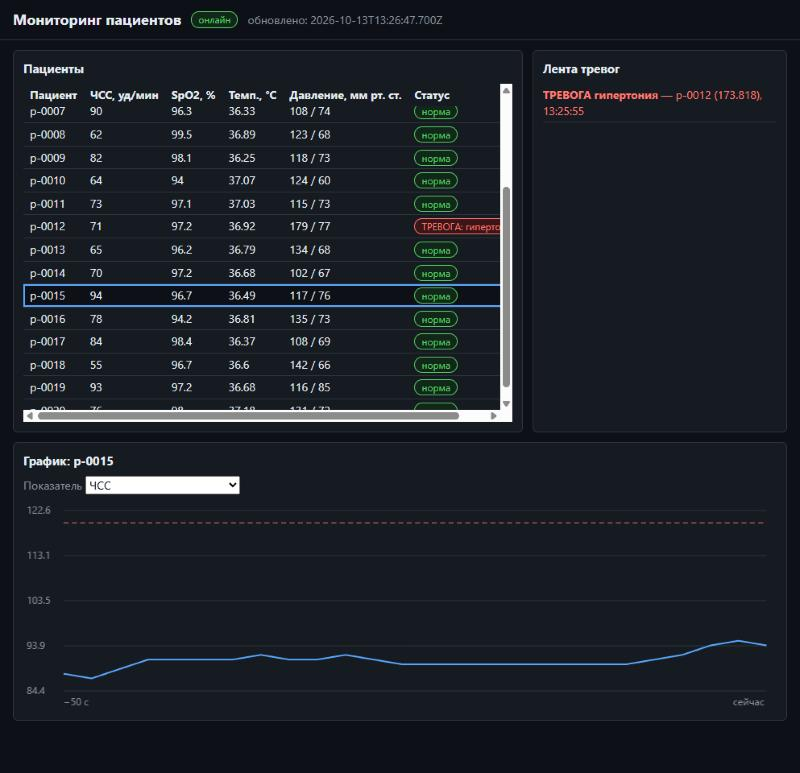

# Задание 8. Веб-дашборд с обновлением в реальном времени

**Требование:** дашборд на Streamlit или FastAPI + WebSocket, который показывает текущую
агрегированную статистику и графики, обновляющиеся в реальном времени по мере поступления
данных от сборщика.

## Что сделано

[`vitals/dashboard`](../python/vitals/dashboard) — FastAPI + WebSocket.

- **Создание приложения.** Фабрика `create_app`, подключение к NATS — в lifespan, при
  импорте ничего не поднимается. Дашборд подписан на `vitals.stats` и `vitals.alerts`
  (потоковый анализ, [задание 7](task7-streaming.md)).
- **WebSocket `/ws`.** При подключении клиент сразу получает снимок и последние тревоги,
  дальше — каждое обновление. У каждого клиента своя ограниченная очередь: медленный
  браузер не тормозит рассылку остальным, при переполнении ему уходит свежий снимок.
- **REST.** `/api/snapshot`, `/api/alerts?limit&offset`, `/healthz`.
- **Страница.**
  - таблица пациентов: ЧСС, SpO2, температура, давление, статус тревоги цветом **и**
    текстом;
  - лента тревог;
  - график выбранного пациента и показателя на `<canvas>` — собственный JS без библиотек и
    CDN, с линией порога;
  - автопереподключение WebSocket.
- **Безопасность** (уроки ЛР №12–13):
  - CSP `script-src 'self'`, `connect-src` только к своему хосту, `frame-ancestors 'none'`;
  - `Referrer-Policy: same-origin` — в ЛР №13 `no-referrer` ломал формы из-за `Origin: null`;
  - проверка `Origin` на WebSocket;
  - данные выводятся только через `textContent`.

## Проверка

- **Вручную в браузере** (локальный стенд: NATS, эмулятор на 20 устройств, сборщик,
  анализатор, дашборд):
  - таблица и время «обновлено» меняются каждые 2 с;
  - после выбора пациента строится график ЧСС за последние ~50 с;
  - в ленте — тревога «гипертония» у p-0012 (173,8).
- **CI, e2e:** «дашборд: /api/snapshot не пуст».
- **Тесты** [`test_dashboard.py`](../tests/unit/test_dashboard.py), 19 тестов:
  - эндпоинты и пагинация, 422;
  - CSP и Referrer-Policy;
  - WebSocket с чужим `Origin` отклоняется (1008);
  - медленный клиент не блокирует быстрого;
  - в `static/*.js` нет `innerHTML`.

## Находка

| № | Что было | Решение |
|---|---|---|
| 4 | Первый запуск CI: контейнер дашборда падал с «Directory …/vitals/dashboard/static does not exist». Веб-ресурсы не попадали в колесо, а локальная editable-установка это скрывала | `package-data` в `pyproject.toml`. Тест собирает настоящее колесо и проверяет файлы; падал до правки |
